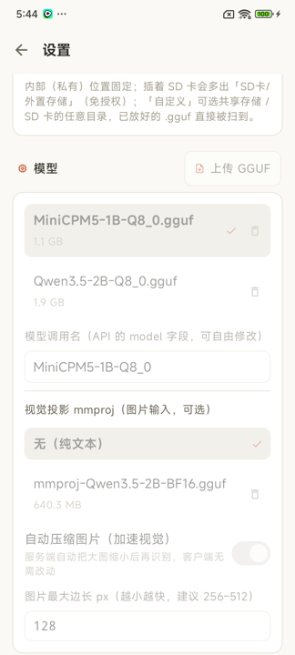
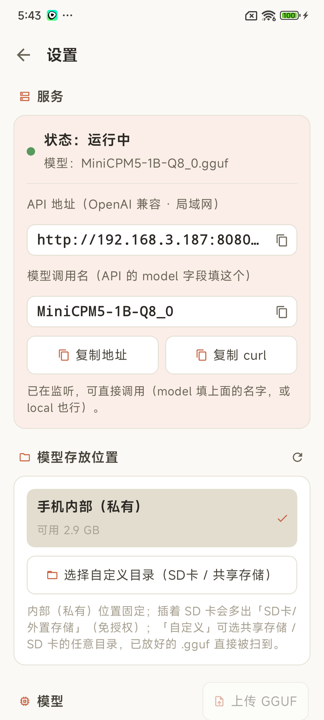

# GGUF 服务器（Android）

在**安卓手机**上一键部署 GGUF 模型，并对外提供 **OpenAI 兼容** 的推理接口（局域网内可用）。

App 本身是一个「进程管理器 + 界面」：你用文件选择器导入一个 `.gguf`，点「启动服务」，它就在手机上跑起
[llama.cpp](https://github.com/ggml-org/llama.cpp) 的 `llama-server`，对外暴露 `http://<手机IP>:8080/v1`。
OpenAI 兼容协议（`/v1/chat/completions`、`/v1/completions`、`/v1/models`、`/v1/embeddings`、流式输出等）
由 `llama-server` 原生实现，无需自己写。

```
┌─────────── 你的电脑 / 其它设备 ───────────┐        ┌──────────── Android 手机 ────────────┐
│  OpenAI SDK / curl / 任意客户端           │  WiFi  │  GGUF 服务器 App（前台服务）          │
│  base_url = http://192.168.x.x:8080/v1  │ ─────► │   └─ llama-server 子进程              │
│                                          │        │        └─ 加载 你上传的 .gguf         │
└──────────────────────────────────────────┘        └──────────────────────────────────────┘
```

---

## 快速使用指南（不用装开发环境，几分钟能跑起来）

### 1. 下载并安装 APK

去 [Releases 页面](https://github.com/NightPoetry/GGUFServer/releases/latest) 下载最新的
`GGUF-Server-release-*.apk`，传到手机后点击安装（首次安装系统会提示「未知来源」，允许即可）。
不想装现成包、想自己编译的话见下方「三步跑起来」。

### 2. 找一个 GGUF 模型文件，放进手机

推荐直接用 **Qwen3.5-2B-Instruct**（多模态、中文强）或 **MiniCPM5-1B**（更小更快，纯文本），
详见下方「推荐的手机可跑模型」。放进手机任选一种方式：

- **手机上直接下载**：用手机浏览器 / Hugging Face App 把 `.gguf` 下载到「Download」目录。
- **电脑上下好，数据线传进去**：
  ```bash
  adb push Qwen3.5-2B-Q8_0.gguf /sdcard/Download/
  ```
  或者用系统「文件」App / 微信 / 网盘把电脑上下好的文件传到手机——效果一样，选你顺手的方式即可。

### 3. 打开 App，上传模型，启动服务

打开「GGUF 服务器」App → 进「设置」→ 点 **上传 GGUF** → 选中刚才放进去的模型 → 点 **启动服务**。
想用图片输入（目前仅 Qwen3.5-2B 支持），把配套的 `mmproj-*.gguf` 也上传一遍，在「视觉投影 mmproj」里选中它：



服务启动后，卡片上会显示局域网 API 地址和模型调用名，可一键复制地址或 curl 命令：



### 4. 在电脑（或任意设备）上调用

确保调用方和手机在**同一个 WiFi**，把地址换成 App 显示的那个——curl / Python 示例见下方「调用（OpenAI 兼容）」一节。

---

## 功能全览（2026-07-10 更新）

在最初「手机上跑 llama-server 对外提供 OpenAI API」的基础上，App 已长成一个完整的本地 AI 工作台：

### 聊天体验
- **零闪烁流式输出**：消息列表反转布局，贴底时由布局系统天然锚定，逐 token 不再滚动跳动；上滑浏览时纹丝不动，浮出「回到底部」按钮一键跳回。
- **Markdown 渲染**：标题/粗斜体/代码块（深色卡片、横向滚动）/列表/表格/引用/链接；正文里模型误写的字面 `\n` 自动还原为真换行（代码块内保留）。
- **每条回复标注平均生成速度**（token/s）：流式实时刷新，结束后用服务端 timings 校准，随会话持久化。
- **时间感**：每条消息带时间戳；跨天消息在上下文里带日期前缀 + 注入「现在时间」，模型不会把前天的「今天下雨」当成今天。

### 交互门户（顶部下拉，选项卡：便签 / 浏览器）
- 打开：顶栏便签图标 / 顶栏下拉 / 消息区上 1/4 下拉（专属拖拽区，不与滚动冲突）；收起：空白处上推 / 上滑 / 箭头 / 返回键；卷帘动画。
- **便签 = 列表结构**：每条一行（序号 + 行内编辑 + ✕ 删除 + 底部添加），防抖自动保存；内容作为背景随每次提问交给模型（放头部 system，不破坏 KV 缓存）。
- **便签修改历史**：最近 100 次快照（手动/模型/清空/恢复都记录），门户便签页右下「历史」可查看、一键恢复。
- **标签**：每会话最多 12 个，历史抽屉按标签分组成可折叠「智能文件夹」检索。
- **内置浏览器**：系统 WebView（无自带内核）+ 地址栏；**模型写完整网页（```html 代码块）会自动拉下门户切到浏览器渲染** —— 让模型帮你写页面、当场看效果。

### 模型的便签操作（1B + 受限解码的正确姿势）
- 说「帮我记一下 / 记到便签」→ 代码路由到专用回合，json_schema 受限解码提取要点写入（比正则截取聪明，能整理措辞）。
- 说「改/删/清空 xx 便签」→ **两阶段管线**：先带上下文「思考」（做什么/对哪条/依据），再用纯净上下文 + 完整动作空间（追加/修改/删除/清空/不操作）执行；序号失效时用 BM25 按原话关键词定位；仍不行则安全拒绝——失败模式只会是「拒绝」，绝不损坏数据（数据坏了也有历史可恢复）。
- 边界语义：重复内容不追加；「删除全部/清空」由代码直接执行；门户里手动编辑永远最高权威。
- 经验：`tools + tool_choice:required` 在 1B 上间歇失效（模板触发标记是懒激活），顶层 `json_schema` 参数从第一个 token 就硬约束，100% 结构可靠。

### 记忆检索（GrowBox 轻量版）
- 上下文的 80% 留给真实近期对话（窗口起点阶梯式移动，保 KV 前缀缓存，长对话轮间只需预填充增量）。
- 溢出窗口的旧消息用 BM25-lite（中文二元组 + 英文词 + IDF）按当前问题检索，最相关的几条带时间戳注入——实测被挤出窗口的事实能被准确「回忆」。
- 短对话（未溢出、当天）零注入，与无此功能时速度完全一致。

### 会话管理
- 历史抽屉：标签智能文件夹 / 删除确认 / 多选批量导出 Markdown。
- 会话数据（消息/便签/标签/历史）全部本地 JSON，不出手机。

## ✅ 已全自动完成并真机验证（2026-07-08）

工具链、native 二进制、APK 全部编译完成，并已在真机（Redmi「ruby」/ Android 14 / 11GB）**装好、跑通、实测 OpenAI 接口可用**（Qwen3.5-2B-Q8_0，CPU ~6 tok/s）。

- **APK**：`GGUF-Server.apk`（项目根目录，约 106MB，含已编译的 arm64 `llama-server`）
- **工具链**：JDK17 / CMake / Gradle / Android SDK+NDK 全装在 `/Volumes/SystemData`（不占系统盘）
- **默认模型**：`Qwen3.5-2B-Q8_0.gguf`（来自你的 `小模型轮椅/build_model/`）

**App 功能**：一键上传 GGUF · 启停服务 · **内置预览聊天**（暖色界面 · 流式输出 · **历史会话**可切换/删除）·
**可选存放目录（内部/SD卡，省空间）** · **真删除（带确认）** ·
**关闭思考模式开关**（默认开，Qwen3.x 这类思考模型才不会把回复都用在思考上）· `--no-mmap` 开关 ·
**可自由修改的模型调用名** · **图片输入（mmproj 视觉模型）+ 服务端图片自动压缩** ·
**醒目的局域网 API 地址卡**（显示地址 + 模型调用名，一键复制地址 / curl）· 前台服务常驻 · 实时日志。

**界面结构**：服务器配置在「设置」页（分组卡片式：服务 / 存放位置 / 模型 / 运行参数 / 日志）——服务**未启动**时打开 App 直接就是设置页；
**启动成功后自动进入聊天**，右上角依次是**历史会话、新对话、模型配置、服务器图标（呼吸灯：绿=运行中，橙=重启中；点击进设置）**；
输入卡底部淡显当前模型名；服务停止/出错会自动退回设置页。历史会话存在应用私有目录，随时切换（消息区向右滑 = 历史，向左滑 = 模型配置）。
**模型配置**（System Prompt / 温度 / Top-P / 发送后收起键盘）点「应用」后自动重启服务生效——温度/Top-P 会成为对外 API 的默认采样参数，System Prompt 仅作用于本机预览聊天。
**内置安全提示词**：本机聊天默认带一条安全系统提示词（拒绝现实危害指导；虚构内容涉危险行为自动附「现实中请勿模仿」；医疗话题自动附「仅供参考，如有不适请及时就医」）；
用户自填 System Prompt 时**整体无感覆盖**。提示词恒定且置于消息最前，命中 llama-server 前缀缓存——实测第二条消息起 KV 直接复用（cached_tokens 138/153），不重复预填充。
**聊天增强**：模型回复按 **Markdown 渲染**（标题/粗斜体/行内代码/代码块/列表/引用/表格/分隔线/链接，零依赖自绘、流式时光标跟随）；
每条消息（提问/回复）下都有「复制」（复制的是原始 MD 文本）；删除会话需确认；历史抽屉「导出…」可多选会话批量导出为 Markdown（走系统另存为）。
**模型存放**：内部（私有）位置固定；插着 SD 卡会出现「SD卡/外置存储」（app 专属目录，免授权）；
「选择自定义目录」可把模型放到共享存储 / SD 卡的任意目录（已放好的 .gguf 直接被扫到；目录不可读时界面会引导开启「所有文件访问」权限）。
旧版的「手机存储（可管理）」与内部同盘、Android 11+ 又不可见，已移除——仅当里面已有模型时以「手机存储（旧位置）」保留展示。
预览聊天走 `127.0.0.1:<端口>`，与外部客户端完全同一条链路（含 API Key、图片压缩代理）。

> - API 的 `model` 字段填 App 里显示的「模型调用名」（可在界面自由修改，如 `Qwen3.5-2B-Q8_0`）；填 `local` 也接受。
> - **图片输入**：把模型配套的 `mmproj-*.gguf` 也「上传」进去，在模型下方选中它即可。请求用 OpenAI 视觉格式：
>   ```json
>   {"model":"local","messages":[{"role":"user","content":[
>     {"type":"text","text":"描述这张图"},
>     {"type":"image_url","image_url":{"url":"data:image/png;base64,<BASE64>"}}]}]}
>   ```
> - **图片自动压缩**：App 内置一个前置代理，会把请求里的大图自动缩到「图片最大边长」（默认 **256px**）
>   再喂给 llama-server，客户端**无需改动**。手机 CPU 跑视觉很慢，务必开着：256px 一张图约 **40 秒**，
>   384px 约 85 秒，1024px 原图会直接超时。**客户端超时请设大（如 300 秒）。** 想更清晰就调大边长（更慢）。

**装到手机（唯一需要你做的）：**
1. 手机用数据线连电脑 → 开启「开发者选项 → USB 调试」→ 手机弹窗点「允许」
2. 在本目录运行：
   ```bash
   ./deploy.sh                 # 装 App + 把默认模型推到手机 Download
   # 或指定别的模型： ./deploy.sh /path/to/xxx.gguf
   ```
3. 打开手机上的「GGUF 服务器」App → 允许通知 → 点「上传 GGUF」选 Download 里的模型 → 「启动服务」
4. App 会显示 `http://<手机IP>:8080/v1`，电脑上同 WiFi 即可调用（见下方示例）

> 没有数据线/不想连电脑？直接把 `GGUF-Server.apk` 传到手机点击安装，再用手机「文件」App 或微信/网盘把 `.gguf` 传到手机即可。
>
> 改代码或换 llama.cpp 版本后想重编：`./rebuild.sh`。

---

## 为什么是这个架构

- **iOS 做不到**：沙盒会杀后台服务器、禁止加载任意文件、分发还要开发者账号。Android 才适合「跑服务器 + 上传任意 GGUF」。
- **不自己写推理/HTTP**：`llama-server` 已经把 OpenAI 兼容接口做全了，直接复用最稳。
- **二进制怎么在手机上跑**：现代 Android 禁止执行 App 数据目录里的文件（`noexec`）。唯一可写又可执行的地方是
  `nativeLibraryDir`——也就是 APK 里 `jniLibs/` 解压出来的目录。所以我们把 `llama-server` **改名成
  `libllamaserver.so`** 塞进 `jniLibs/arm64-v8a/`，安装时被解压到有执行权限的目录，再用 `ProcessBuilder` 拉起。

详见 [`docs/架构与原理.md`](docs/架构与原理.md)。

---

## 目录结构

```
.
├── README.md
├── docs/架构与原理.md
├── scripts/build-llama-android.sh   # 交叉编译 llama-server → 放进 jniLibs
└── android/                         # Android Studio 工程
    └── app/src/main/
        ├── AndroidManifest.xml
        ├── java/com/ggufserver/app/
        │   ├── MainActivity.kt / MainViewModel.kt / App.kt / ServerBus.kt
        │   ├── server/LlamaServerService.kt   # 前台服务：拉起并守护 llama-server 进程
        │   ├── data/ModelStore.kt             # 导入/管理 .gguf
        │   ├── util/NetworkUtils.kt           # 取局域网 IP
        │   └── ui/AppScreen.kt                # Compose 界面
        └── jniLibs/arm64-v8a/                 # 编译产物落这里（默认空）
```

---

## 前置条件

- 一台 **arm64 安卓手机**，Android 9（API 28）及以上。近 8 年的机器基本都是 arm64。
- 开发机（你的 Mac）装好：
  - **Android Studio**（含 Android SDK）
  - **Android NDK**（r26 及以上）——Android Studio 的 SDK Manager → SDK Tools → 勾选 NDK 即可
  - **cmake**、**git**（`brew install cmake git`）

---

## 三步跑起来

### 第 1 步：编译 llama-server 并放进工程

```bash
# 指向你的 NDK 路径（版本号按实际改）
export ANDROID_NDK="$HOME/Library/Android/sdk/ndk/26.3.11579264"

./scripts/build-llama-android.sh
```

脚本会：克隆 llama.cpp → 用 NDK 交叉编译 `llama-server`（arm64）→ 把可执行文件（改名 `libllamaserver.so`）
和它依赖的 `libllama.so / libggml*.so / libmtmd.so` 全部拷进 `android/app/src/main/jniLibs/arm64-v8a/`。

> 想要更快？如果你的手机较新（骁龙 8 系、天玑 9000+、Google Tensor 等），可开启现代指令集：
> ```bash
> CPU_MARCH="armv8.2-a+dotprod+i8mm" ./scripts/build-llama-android.sh
> ```
> 老机器请用默认（基线 armv8-a），否则可能因不支持的指令而崩溃。

### 第 2 步：编译并安装 APK

1. 用 Android Studio **打开 `android/` 目录**，等它 Gradle Sync 完成（首次会自动下载 Gradle/依赖）。
2. 手机开启「开发者选项 → USB 调试」，插上数据线。
3. 点 **Run ▶**（或菜单 Build → Build APK，然后把 `app-debug.apk` 发到手机安装）。

命令行方式（可选）：
```bash
cd android
./gradlew assembleDebug          # 产物：app/build/outputs/apk/debug/app-debug.apk
./gradlew installDebug           # 手机已连 USB 时直接装
```
> 若没有 `gradlew`：先在 Android Studio 里打开一次工程（会自动生成 wrapper），或本机装了 Gradle 后执行 `gradle wrapper`。

### 第 3 步：上传 GGUF，启动服务

1. 打开 **GGUF 服务器** App，允许通知权限。
2. 点 **上传 GGUF**，从手机存储选一个 `.gguf`（先用系统「文件」App 把模型放到手机上，或用数据线 `adb push`）。
3. （可选）展开「运行参数」调端口 / 上下文 / 线程 / API Key。
4. 点 **启动服务**。状态变「运行中」后，卡片上会显示地址，例如 `http://192.168.1.23:8080/v1`。

---

## 调用（OpenAI 兼容）

确保调用方与手机在**同一个 WiFi**。把 `192.168.1.23:8080` 换成 App 显示的地址。

**curl：**
```bash
curl http://192.168.1.23:8080/v1/chat/completions \
  -H "Content-Type: application/json" \
  -d '{"model":"local","messages":[{"role":"user","content":"你好，介绍一下你自己"}]}'
```

**Python（openai 官方 SDK）：**
```python
from openai import OpenAI
client = OpenAI(base_url="http://192.168.1.23:8080/v1", api_key="不填也行")
resp = client.chat.completions.create(
    model="local",
    messages=[{"role": "user", "content": "你好"}],
)
print(resp.choices[0].message.content)
```
> `model` 字段随便填，`llama-server` 只加载了你选的那个模型。若在 App 里设置了 API Key，则 `api_key` 要填成一致，
> 请求头会带 `Authorization: Bearer <key>`。

---

## 推荐的手机可跑模型（GGUF）

手机内存有限，优先 1B–2B 档位；本项目全程真机验证用的就是下面两个，不是随便挑的老模型：

| 模型 | 量化 | 大约体积 | 说明 |
|---|---|---|---|
| **Qwen3.5-2B-Instruct**（推荐） | Q8_0 | ~2.2 GB | **首选**：中文强、支持工具调用、**自带多模态**（配 `mmproj` 可读图）；App 里的插件生态（视觉相关能力）也是照它测的。8GB+ 内存手机优先选它 |
| MiniCPM5-1B | Q8_0 | ~1.2 GB | 更小更快（本项目多数延迟基准用的是它），但**不支持图片输入**；内存紧张（≤6GB）的老机型可选这个 |

**多模态别漏下载**：选 Qwen3.5-2B 想要图片输入功能，除了主模型文件，**还要额外下载配套的 `mmproj-*.gguf`**（同一个模型仓库下、体积小很多的那个文件）——App 里两个都要「上传 GGUF」，在模型下方选中 mmproj 才会启用图片输入（见下方“调用”一节的示例）。只下主模型、不下 mmproj 是纯文本，功能不会报错但也用不了图片。

去 Hugging Face 搜 `Qwen3.5-2B-Instruct-GGUF` 或 `MiniCPM5-1B-GGUF` 下载对应量化文件。经验：**模型体积 < 手机可用内存的一半** 比较稳。

---

## 分发给别人安装（已配置正式签名）

- 发布包：项目根目录的 `release/` 文件夹（正式签名，直接发给别人侧载安装即可），按版本号留档，
  如 `release/GGUF-Server-release-1.0.2.apk`；旧版本一律保留不覆盖。
- 重新打发布包：先把 `android/app/build.gradle.kts` 的 `versionName`/`versionCode` 升一版，
  再跑 `./scripts/release.sh`（同名文件已存在会报错，提醒你忘了升版本号）。详见 [`docs/打包流程.md`](docs/打包流程.md)。

  | 版本 | 日期 | 说明 |
  |---|---|---|
  | 1.0 | 2026-07-10 | 首个正式包（插件化改造前）：`release/GGUF-Server-release-1.0.apk` |
  | 1.0.1 | 2026-07-11 | 工具插件系统：网关中间件、便签/记忆插件化、ChatViewModel 纯流式瘦身 |
  | 1.0.2 | 2026-07-11 | 提示词中间件插件；重试 + ‹K/N› 候选切换；门户 tab 切换修复；方形图标；记忆面板重排版；内置插件禁止卸载（保数据）；插件状态原子写 |
- 签名密钥：`android/keystore/ggufserver-release.jks`（alias `ggufserver`）。密码不写在这——真实值在
  `config/secrets/keystore.properties`（已 gitignore，模板见 `config/keystore.properties.example`）。
  **主备份在 `/Volumes/UserData/秘钥存储/安卓秘钥/GGUF服务器/`（含密钥库 + 秘钥说明.md）**，
  工程里这份是工作副本，损坏时从主备份恢复。丢了密钥就无法给老用户发同签名升级包。
- ⚠️ 自己开发机连的手机装的是 debug 签名版，**不要**直接用 release 包覆盖安装
  （签名不同必须先卸载，会清掉聊天记录和已导入的模型）。开发继续用 `./rebuild.sh` + debug 包。

## 安全说明（重要）

- 本方案默认监听 `0.0.0.0`，**同一局域网内任何人都能访问**。家用 WiFi 一般没问题，公共 WiFi 请务必：
  - 在「运行参数」里设一个 **API Key**；
  - 不要做端口转发 / 内网穿透把它暴露到公网（你选了「仅局域网」，保持这样最安全）。
- 若以后要公网访问，建议加 Cloudflare Tunnel/frp 并**必须**开 API Key 鉴权。

---

## 常见问题

- **API 调用感觉比 App 里聊天慢很多 / 半天没反应**：生成速度其实一样——App 内是流式（边生成边显示），
  而 OpenAI SDK / curl **默认非流式**，要等整段回复生成完才返回（手机 CPU 几 token/s，一段话就是几十秒干等）。
  客户端加 `"stream": true` 即可（curl 记得配 `-N`；SDK 用 `stream=True` 逐 chunk 读）。
  实测同一问题：流式 1.8 秒见字，非流式 17 秒才返回。
- **启动即退出 / 日志报 `libxxx.so not found`**：说明 `jniLibs` 里缺 `.so`。重跑第 1 步，确认目录里有
  `libllamaserver.so` 和一组 `libggml*.so / libllama.so`。
- **崩溃、`SIGILL`**：编译时开了手机不支持的指令集。改用默认（不带 `CPU_MARCH`）重新编译。
- **加载模型失败 / OOM**：模型太大。换更小的模型，或把「上下文长度」调到 2048、线程调到 2–4。
- **跑一会就变慢/断开**：手机发热降频。降低线程数（`-t` 2–4）、缩短上下文；插着充电、别捂着。
- **外部连不上**：确认调用方和手机同一 WiFi；部分路由器开了「AP 隔离」会挡设备互访，需在路由器关闭。
- **端口被占**：换个端口（如 8090）。注意：开了「自动压缩图片」时，llama-server 实际监听 `端口+1`（内部），
  对外端口由内置代理占用——这是正常的。
- **一直显示「启动中」**：应已修复（App 声明了 `usesCleartextTraffic`，健康检查才能连本机 llama-server）。若自编
  旧版遇到，确认 manifest 里有 `android:usesCleartextTraffic="true"`。
- **息屏后断了**：App 已申请 CPU/WiFi 唤醒锁并跑前台服务；个别厂商 ROM 仍会激进省电，请到系统设置里给本 App
  关闭「电池优化 / 后台限制」，并允许「后台常驻」。

---

## 其它路线（备忘）

- **只想快速验证、不装 App**：用 **Termux** 直接 `pkg install` 工具链后 `cmake` 编译 `llama-server`，
  `llama-server -m model.gguf --host 0.0.0.0 --port 8080` 即可。功能一样，只是没有「一键上传」界面。
- **GPU 加速现状（实测结论）**：可以为 Android 编出带 **Vulkan** 后端的 `llama-server`（需额外补 NDK 缺失的
  Khronos 依赖：SPIRV-Headers、Vulkan-Headers 的 `vulkan.hpp`、以及 `spirv.hpp` 的 include）。但在本机
  （Mali-G68）实测：**Qwen3.5/3.6 这类用 "Gated Delta Net"（线性注意力）的模型一加载就 segfault**——llama.cpp 的
  Vulkan 后端目前不支持该算子（日志：`fused Gated Delta Net tensor is assigned to device Vulkan0 (missing support)`）。
  所以对这类模型 GPU 暂不可行；要等上游补算子，或改用标准 Transformer 架构的模型。**当前最实际：CPU + 图片压缩 + 小图。**
- **iOS**：受限较多（前台运行、文件导入受限、需开发者账号），本仓库不覆盖。

---

## 许可证

本项目基于 [Apache License 2.0](./LICENSE) 开源，另附加了强制署名条款
（[ADDITIONAL_TERMS.md](./ADDITIONAL_TERMS.md)）：任何分发本项目源码、
二进制产物或其衍生作品的产品，须在开发者名单中署名 "MaxX5"，并在公开
介绍其开发团队的场合一并注明。仅通过网络调用本项目部署后暴露的 API
不受此条款约束。完整署名要求见 [NOTICE](./NOTICE)。
